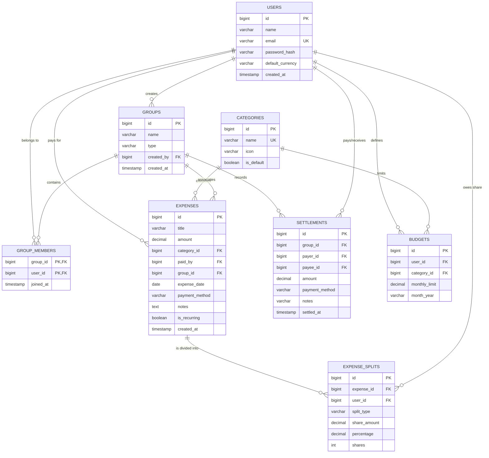

# ExpenseSync: Expense Management System with Splitwise-Style Bill Splitting

[](https://www.srmist.edu.in/)
[](https://www.srmist.edu.in/)
[](https://github.com/)
[](LICENSE)

> A modern full-stack web application combining **Personal Expense Tracking** (budgets, category spending limits, overspend warnings, CSV reporting) with **Collaborative Bill Splitting** (groups, 4 split models, and greedy minimum-cash-flow debt simplification).

---

## 1. Project Overview & Architecture

ExpenseSync is designed following the 5-unit curriculum of **21CSE354T Full Stack Web Development (SRMIST)**. The repository is organized unit-wise, allowing evaluators to run, inspect, and grade each unit independently while also providing a unified production-ready microservices build in `final-project/`.

### System Architecture Diagram
```mermaid
flowchart TD
    subgraph Client Tier [Client Tier - React + Vite (Port 5173)]
        UI[Single Page Application<br>React Router, Axios, ThemeContext, AuthContext]
        DOM[DOM / Canvas 2D Charts]
    end

    subgraph Core Service [Core Service (Spring Boot - Port 8080)]
        direction TB
        SEC[Spring Security &amp; JwtAuthenticationFilter]
        CTRL[REST Controllers<br>ExpenseController, GroupController, AuthController]
        SERV[Service Layer<br>SplitCalculationService, DebtSimplificationService]
        REPO[Spring Data JPA Repositories]
    end

    subgraph Analytics Microservice [Analytics Microservice (Spring Boot - Port 8082)]
        ACTRL[AnalyticsController]
        ASERV[AnalyticsService<br>Monthly Reports &amp; CSV Streaming]
    end

    subgraph Data Tier [Persistence Tier]
        MYSQL[("MySQL 8.0 / H2 Database<br>Relational Schema with 8 Tables")]
    end

    UI -->|HTTP Requests + Bearer JWT| SEC
    SEC --> CTRL
    CTRL --> SERV
    SERV --> REPO
    REPO -->|JDBC / Hibernate| MYSQL
    SERV -->|"Inter-Service REST Call<br>(RestTemplate /api/analytics)"| ACTRL
    ACTRL --> ASERV
```

### Entity-Relationship (ER) Diagram


---

## 2. Unit-Wise Structure (Syllabus Mapping)

| Unit | Focus Topic | Directory | Key Deliverables & Tech |
| :--- | :--- | :--- | :--- |
| **Unit 1** | **HTML5 & CSS3 Foundation** | [`unit-1/`](unit-1/README.md) | 7 semantic static pages, Flexbox/Grid, pure HTML5 Canvas donut chart, dark/light theme CSS variables. |
| **Unit 2** | **JavaScript & React JS** | [`unit-2/`](unit-2/README.md) | **Part A**: Vanilla JS DOM split calculator with 4 split algorithms.<br>**Part B**: React 18 SPA (Vite), custom hooks (`useExpenses`, `useDebounce`) with `useDebugValue`, Context API. |
| **Unit 3** | **SQL & JDBC Data Access** | [`unit-3/`](unit-3/README.md) | Normalized relational schema (8 tables), joins, subqueries, `UNION/INTERSECT/EXCEPT`, and Java 17 JDBC CLI application with PreparedStatement CRUD. |
| **Unit 4** | **Spring Boot Part 1** | [`unit-4/`](unit-4/README.md) | Layered REST API (`Controller` $\rightarrow$ `Service` $\rightarrow$ `Repository`), DTOs, Bean Validation, Global Exception Handling, Greedy Min-Cash-Flow Debt Simplification, JUnit 5 tests. |
| **Unit 5** | **Spring Boot Part 2 & Microservices** | [`unit-5/`](unit-5/README.md) | Spring Data JPA (MySQL/H2 dual profile), stateless JWT Auth, Analytics microservice (port 8082), inter-service `RestTemplate` calls, connected React client with Axios. |
| **Final** | **Consolidated Production Build** | [`final-project/`](final-project/) | Unified Docker Compose stack (`mysql-db`, `core-service`, `analytics-service`, `frontend`). |
| **Docs** | **Project Documentation** | [`docs/`](docs/) | SRS, Mermaid Architecture & ER diagrams, API Docs, Postman collection, College Project Report outline. |

---

## 3. Core Features Breakdown

### A. User & Authentication
* Multi-user registration with validation (valid email, 8+ character password, unique constraint).
* BCrypt password hashing.
* Stateless JSON Web Token (JWT) issuing and client-side storage with auto-logout handling on expiry.
* Multi-currency support (INR ₹ default, USD $, EUR €).

### B. Personal Expense Tracker
* Full CRUD (Create, Read, Update, Delete) for personal expenses with title, amount, category, date, and payment method (UPI, Card, Cash, Bank).
* Standard categories (Food, Travel, Rent, Shopping, Bills, Entertainment, Health, Other) + custom categories.
* Recurring expense flagging (Monthly rent, Netflix, WiFi bill).
* Debounced search, category filter, payment method filter, date/amount sorting, pagination, and CSV export.

### C. Category Budgets & Warnings
* Monthly budget limits set per category and an overall monthly limit.
* Dynamic visual progress meters.
* **80% Caution Alert**: Amber alert when category spending reaches 80% threshold.
* **100% Over-Budget Alert**: Red alert banner preventing inadvertent overspending.

### D. Group Expenses & 4 Splitwise Split Types
* Create groups (Trip, Home, Couple, Other) and add members via email.
* Group expense feed with date, payer, and category.
* **4 Split Methods**:
  1. **Equal Split**: Divided equally among selected members.
  2. **Exact Amounts**: Explicit currency inputs summing to total bill.
  3. **Percentages**: Percentage shares summing to exactly 100%.
  4. **Shares (Ratio)**: Integer ratios (e.g. 2:1:1:1).
* **Paise/Cent Rounding Absorption**: Fractional remainders are absorbed automatically by the last member so sum of shares matches total bill with mathematical precision.

### E. Greedy Debt Simplification & Settle-Up
* Implements the **Greedy Minimum-Cash-Flow Algorithm** to minimize total settlement transactions across large groups with circular debts.
* **Settle Up**: Record payments between two members (full or partial) with instant net balance recalculation and historical settlement logs.

---

## 4. REST API Endpoints Overview

| Method | Endpoint | Description | Service | Port |
| :--- | :--- | :--- | :--- | :--- |
| `POST` | `/api/auth/register` | Register new user and receive JWT | Core | 8080 |
| `POST` | `/api/auth/login` | Authenticate user and receive JWT | Core | 8080 |
| `GET` | `/api/auth/me` | Fetch authenticated user profile | Core | 8080 |
| `GET` | `/api/expenses` | List, search, and filter personal/group expenses | Core | 8080 |
| `POST` | `/api/expenses` | Add expense (personal or group with split) | Core | 8080 |
| `PUT` | `/api/expenses/{id}` | Update existing expense | Core | 8080 |
| `DELETE` | `/api/expenses/{id}`| Delete expense | Core | 8080 |
| `GET` | `/api/groups` | List all groups and member net balances | Core | 8080 |
| `GET` | `/api/groups/{id}/simplified-debts` | Compute minimum cash flow transfers | Core | 8080 |
| `POST` | `/api/settlements` | Record debt settlement payment | Core | 8080 |
| `GET` | `/api/reports/analytics` | Inter-service proxy call for analytics | Core | 8080 |
| `GET` | `/api/analytics/summary` | Generate monthly report & spending breakdown | Analytics | 8082 |
| `GET` | `/api/analytics/export-csv` | Stream CSV report download | Analytics | 8082 |

---

## 5. Quick Start Guide

### Prerequisites
* Java Development Kit (JDK 17+)
* Apache Maven (3.8+)
* Node.js (18+) & npm
* Git

---

### Running Unit by Unit

#### Unit 1: HTML5 & CSS3
```bash
cd unit-1
open index.html
# Or: npx serve .
```

#### Unit 2: JavaScript & React JS
```bash
# Part A: Vanilla JS Split Calculator
cd unit-2/part-a-vanilla-js
open index.html

# Part B: React Application
cd ../part-b-react
npm install
npm run dev
```

#### Unit 3: SQL & JDBC Console App
```bash
cd unit-3/jdbc-app
mvn clean compile exec:java
```

#### Unit 4: Spring Boot Layered REST API & JUnit 5 Tests
```bash
cd unit-4
mvn clean test             # Run 6 automated test cases
mvn spring-boot:run        # Start REST API on port 8080
```

#### Unit 5: JPA Core Service + Microservice + Connected React Client
```bash
# Terminal 1: Analytics Microservice
cd unit-5/analytics-service
mvn spring-boot:run

# Terminal 2: Core Service
cd unit-5/core-service
mvn spring-boot:run

# Terminal 3: React Client
cd unit-5/client
npm install
npm run dev
```

---

### Running via Docker Compose (Unified Stack)
```bash
cd final-project
docker-compose up --build
```
* **Frontend**: `http://localhost:5173`
* **Core API**: `http://localhost:8080`
* **Analytics Microservice**: `http://localhost:8082`
* **MySQL Database**: `localhost:3306`

---

## 6. Seed Demo Credentials

| Role | Name | Email | Password |
| :--- | :--- | :--- | :--- |
| **Primary User** | Rahul Sharma | `rahul@example.com` | `Password@123` |
| **Member 2** | Priya Nair | `priya@example.com` | `Password@123` |
| **Member 3** | Amit Patel | `amit@example.com` | `Password@123` |
| **Member 4** | Sneha Rao | `sneha@example.com` | `Password@123` |

---

## 7. Future Scope
* **OCR Receipt Scanner**: Automated expense digitization using Google Cloud Vision API.
* **WebSocket Live Feed**: Real-time push updates for instant group settlement notifications.
* **Native UPI Deep-Linking**: Integration with `upi://pay` URI schemes for immediate mobile banking app settlement.

---

## 8. License & Academic Attribution
Developed as an academic capstone submission for **21CSE354T Full Stack Web Development** at **SRM Institute of Science and Technology**. Released under the [MIT License](LICENSE).
