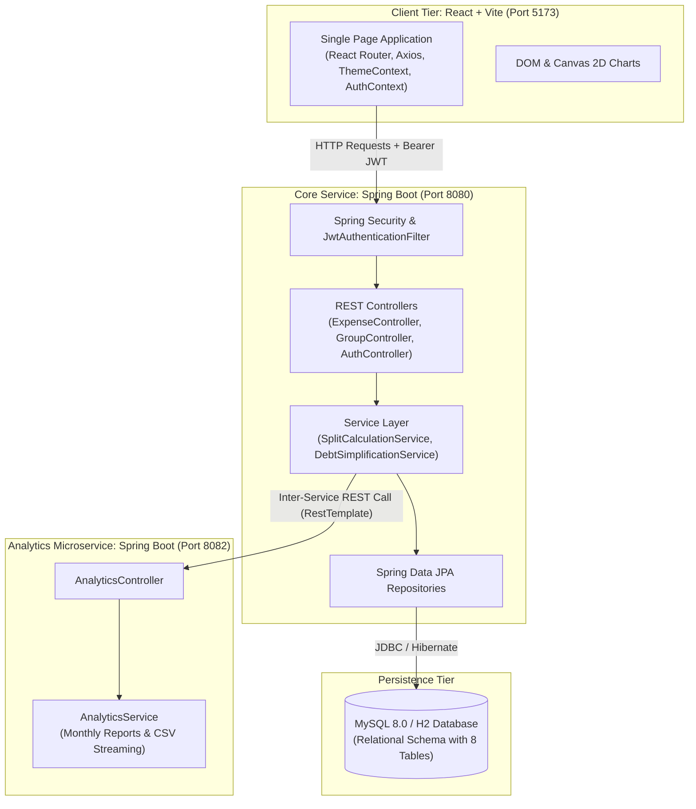
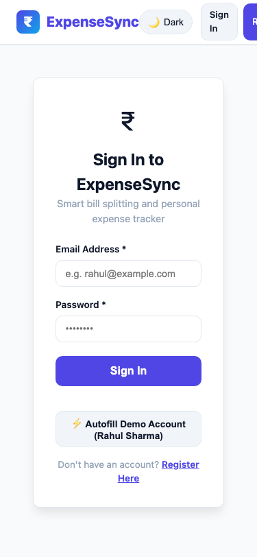

# ExpenseSync: Expense Management System with Splitwise-Style Bill Splitting

[](https://www.srmist.edu.in/)
[](https://www.srmist.edu.in/)
[](https://github.com/)
[](LICENSE)

> A modern full-stack web application combining **Personal Expense Tracking** (budgets, category spending limits, overspend warnings, CSV reporting) with **Collaborative Bill Splitting** (groups, 4 split models, and greedy minimum-cash-flow debt simplification).
> Built to satisfy the complete 5-unit syllabus of 21CSE354T Full Stack Web Development at SRMIST.

---

## ⚡ Quick-Start (Run Unit-5 in 3 Commands)

To run the full-stack connected application with zero database setup (uses automated in-memory H2 database profile):

```bash
# 1. Start Analytics Microservice (Port 8082)
mvn -f unit-5/analytics-service/pom.xml spring-boot:run

# 2. Start Core Service Backend (Port 8080)
mvn -f unit-5/core-service/pom.xml spring-boot:run -Dspring-boot.run.profiles=h2

# 3. Start React Web Client (Port 5173)
cd unit-5/client && npm install && npm run dev
```

Open **`http://localhost:5173`** in your browser and log in with:
* **Email**: `rahul@example.com`
* **Password**: `Password@123`

To run the automated 8-step end-to-end integration test suite:
```bash
chmod +x ./e2e_test.sh && ./e2e_test.sh
```

---

## 📚 Syllabus Mapping (21CSE354T Full Stack Web Development)

| Unit | Syllabus Module & Hours | Project Component | Path | Key Concepts Demonstrated |
| :--- | :--- | :--- | :--- | :--- |
| **Unit 1** | **HTML5 & CSS3** (9 Hours) | Static Multi-Page Site | [`unit-1/`](unit-1/README.md) | Semantic tags, validation, Flexbox, Grid, keyframe animations, Canvas 2D donut chart, dark/light CSS variables. |
| **Unit 2** | **JavaScript & React JS** (9 Hours) | Dynamic Client Apps | [`unit-2/`](unit-2/README.md) | **Part A**: Vanilla JS DOM, ES6 array methods, 4 split algorithms with paise rounding, Canvas Confetti.<br>**Part B**: React 18 SPA (Vite), custom hooks (`useExpenses`, `useDebounce`) with `useDebugValue`, Context API (`ThemeContext`, `AuthContext`), budget progress meters. |
| **Unit 3** | **SQL & JDBC** (9 Hours) | Relational DB & CLI | [`unit-3/`](unit-3/README.md) | 8-table relational schema (`schema.sql`), seed data (`seed.sql`), multi-table joins, subqueries ("Who Owes Whom"), `UNION/INTERSECT/EXCEPT`, and Java 17 JDBC CLI (`PreparedStatement`, `ResultSet`, connection pooling). |
| **Unit 4** | **Spring Boot Part 1** (9 Hours) | Layered REST API | [`unit-4/`](unit-4/README.md) | Controller $\rightarrow$ Service $\rightarrow$ Repository architecture, DTOs, Jakarta Bean Validation, `@RestControllerAdvice`, Greedy Minimum-Cash-Flow Algorithm, JUnit 5 test suite (6 test cases), Postman collection. |
| **Unit 5** | **Spring Boot Part 2 & Microservices** (9 Hours) | Full Stack & Microservices | [`unit-5/`](unit-5/README.md) | Spring Data JPA (MySQL & H2 profiles), stateless JWT authentication (HMAC-SHA256, BCrypt), dedicated Analytics microservice (port 8082), inter-service `RestTemplate` calls, connected React client with Axios. |
| **Final** | **Consolidated Capstone** | Production Stack | [`final-project/`](final-project/README.md) | Unified Docker Compose deployment (`mysql-db`, `core-service`, `analytics-service`, `frontend`). |
| **Docs** | **Engineering & Viva Prep** | Formal Documentation | [`docs/viva-prep.md`](docs/viva-prep.md) | SRS, 25-Question Comprehensive Viva Guide, Architecture & ER diagrams, API Docs, Postman collection. |

---

## 📂 Repository Structure

```text
expense-sync/
├── unit-1/                 # HTML5 & CSS3 (7 static semantic pages + CSS styling)
│   ├── screenshots/        # UI screenshots across all 7 pages + mobile viewport
│   └── README.md           # Unit 1 documentation and concept guide
├── unit-2/                 # JavaScript DOM & React JS SPA
│   ├── part-a-vanilla-js/  # DOM manipulation, 4 split algorithms, canvas confetti
│   ├── part-b-react/       # Vite React 18, custom hooks, context, charts
│   ├── screenshots/        # Unit 2 screenshots
│   └── README.md           # Unit 2 documentation
├── unit-3/                 # SQL & JDBC Console Application
│   ├── schema.sql          # 8-table relational DDL schema
│   ├── seed.sql            # Seed datasets with test users, groups, expenses
│   ├── queries.sql         # 10 advanced SQL queries (Joins, Aggregations, Set ops)
│   ├── jdbc-app/           # Java 17 JDBC CLI application with connection pooling
│   ├── screenshots/        # CLI execution proof
│   └── README.md           # Unit 3 documentation
├── unit-4/                 # Spring Boot Layered REST API & JUnit 5 Tests
│   ├── src/                # Controller -> Service -> Repository layered backend
│   ├── screenshots/        # JUnit 5 test passing & Postman execution
│   └── pom.xml             # JUnit 5, Mockito, Jakarta Bean Validation
├── unit-5/                 # Full Stack Microservices & Connected Client
│   ├── core-service/       # Spring Boot (8080) JPA, Spring Security, JWT, H2/MySQL
│   ├── analytics-service/  # Spring Boot (8082) Monthly analytics & CSV microservice
│   ├── client/             # Production React 18 frontend with Axios & real API hooks
│   ├── screenshots/        # Unit 5 walkthrough screenshots
│   └── README.md           # Unit 5 architecture documentation
├── final-project/          # Consolidated Capstone Architecture
│   ├── docker-compose.yml  # Multi-container orchestration (Core, Analytics, Client, DB)
│   ├── core-service/       # Microservice copy for standalone deployment
│   ├── analytics-service/  # Microservice copy for standalone deployment
│   ├── frontend/           # React frontend copy for Docker build
│   ├── screenshots/        # Capstone walkthrough screenshots
│   └── README.md           # Docker architecture and deployment instructions
├── docs/                   # Formal Academic & Viva Artifacts
│   ├── srs.md              # Software Requirements Specification (SRS)
│   ├── viva-prep.md        # Comprehensive 25-Question Viva Preparation Guide
│   ├── project-report.md   # Academic project report outline
│   └── screenshots/        # Master screenshot gallery
├── e2e_test.sh             # Automated 8-phase end-to-end bash test suite
└── README.md               # Master documentation and examiner demo script
```

---

## 🔑 Seed Demo Credentials

| Role | Name | Email | Password |
| :--- | :--- | :--- | :--- |
| **Primary User** | Rahul Sharma | `rahul@example.com` | `Password@123` |
| **Member 2** | Priya Nair | `priya@example.com` | `Password@123` |
| **Member 3** | Amit Patel | `amit@example.com` | `Password@123` |
| **Member 4** | Sneha Rao | `sneha@example.com` | `Password@123` |

---

## 1. Project Architecture & ER Diagrams

### System Architecture Diagram


### Entity-Relationship (ER) Diagram

```mermaid
erDiagram
    USERS ||--o{ GROUPS : "creates"
    USERS ||--o{ GROUP_MEMBERS : "belongs to"
    GROUPS ||--o{ GROUP_MEMBERS : "contains"
    USERS ||--o{ EXPENSES : "pays for"
    CATEGORIES ||--o{ EXPENSES : "classifies"
    GROUPS ||--o{ EXPENSES : "associates"
    EXPENSES ||--o{ EXPENSE_SPLITS : "is divided into"
    USERS ||--o{ EXPENSE_SPLITS : "owes share"
    GROUPS ||--o{ SETTLEMENTS : "records"
    USERS ||--o{ SETTLEMENTS : "pays/receives"
    USERS ||--o{ BUDGETS : "defines"
    CATEGORIES ||--o{ BUDGETS : "limits"

    USERS {
        bigint id PK
        varchar name
        varchar email UK
        varchar password_hash
        varchar default_currency
        timestamp created_at
    }

    GROUPS {
        bigint id PK
        varchar name
        varchar type
        bigint created_by FK
        timestamp created_at
    }

    GROUP_MEMBERS {
        bigint group_id PK,FK
        bigint user_id PK,FK
        timestamp joined_at
    }

    CATEGORIES {
        bigint id PK
        varchar name UK
        varchar icon
        boolean is_default
    }

    EXPENSES {
        bigint id PK
        varchar title
        decimal amount
        bigint category_id FK
        bigint paid_by FK
        bigint group_id FK
        date expense_date
        varchar payment_method
        text notes
        boolean is_recurring
        timestamp created_at
    }

    EXPENSE_SPLITS {
        bigint id PK
        bigint expense_id FK
        bigint user_id FK
        varchar split_type
        decimal share_amount
        decimal percentage
        int shares
    }

    SETTLEMENTS {
        bigint id PK
        bigint group_id FK
        bigint payer_id FK
        bigint payee_id FK
        decimal amount
        varchar payment_method
        varchar notes
        timestamp settled_at
    }

    BUDGETS {
        bigint id PK
        bigint user_id FK
        bigint category_id FK
        decimal monthly_limit
        varchar month_year
    }
```


---

## 2. Visual Walkthrough & System Screenshots

| View | Screenshot | Description |
| :--- | :--- | :--- |
| **Financial Dashboard** |  | Personal budget meters, spending summary cards, category donut chart, and 80% caution alerts |
| **Splitwise Bill Splitting** |  | Group expense feed, live 4-method split preview, and greedy minimum-cash-flow simplified debts |
| **Microservice Analytics** |  | Dedicated microservice (`analytics-service`: 8082) monthly spending breakdown and insights |
| **Mobile Responsive UI** |  | High-contrast, touch-optimized responsive layout tested across mobile viewports (375px) |

---

## 3. Core Features Breakdown

### A. User & Authentication
* Multi-user registration with validation (valid email, 8+ character password, unique constraint).
* BCrypt password hashing (`BCryptPasswordEncoder`).
* Stateless JSON Web Token (JWT) issuing and client-side storage (`localStorage` strictly limited to token and theme).
* Multi-currency support (INR ₹ default, USD $, EUR €).

### B. Personal Expense Tracker
* Full CRUD (Create, Read, Update, Delete) for personal expenses with title, amount, category, date, and payment method (UPI, Card, Cash, Net Banking).
* Standard categories (Food, Travel, Rent, Shopping, Bills, Entertainment, Health, Other).
* Recurring expense tracking.
* Real-time debounced search, category filter, payment method filter, date/amount sorting, and pagination.

### C. Category Budgets & Warnings
* Monthly budget limits set per category and overall monthly limit (e.g. ₹30,000.00 for Rahul).
* Dynamic visual progress meters with color grading.
* **80% Caution Alert**: Amber alert badge when category spending reaches 80% threshold.
* **100% Over-Budget Alert**: Red alert banner highlighting exceeded limits.

### D. Group Expenses & 4 Splitwise Split Types
* Create groups (Trip, Home, Couple, Project) and add members via email.
* Group expense feed with date, payer, and category.
* **4 Split Methods**:
  1. **Equal Split**: Divided equally among selected members.
  2. **Exact Amounts**: Explicit currency inputs summing to total bill.
  3. **Percentages**: Percentage shares summing to exactly 100%.
  4. **Shares (Ratio)**: Integer ratios (e.g. 2:1:1:1).
* **Paise/Cent Rounding Absorption**: Fractional remainders are absorbed automatically by the last member so sum of shares matches total bill with mathematical precision.

### E. Greedy Debt Simplification & Settle-Up
* Implements the **Greedy Minimum-Cash-Flow Algorithm** to minimize total settlement transactions across large groups with circular debts.
* **Settle Up**: Record payments between two members (full or partial) with instant net balance recalculation and historical settlement logs.

---

## 4. REST API Endpoints Overview

| Method | Endpoint | Description | Service | Port |
| :--- | :--- | :--- | :--- | :--- |
| `POST` | `/api/auth/register` | Register new user and receive JWT | Core | 8080 |
| `POST` | `/api/auth/login` | Authenticate user and receive JWT | Core | 8080 |
| `GET` | `/api/auth/me` | Fetch authenticated user profile | Core | 8080 |
| `GET` | `/api/expenses` | List, search, and filter personal/group expenses | Core | 8080 |
| `POST` | `/api/expenses` | Add expense (personal or group with split) | Core | 8080 |
| `PUT` | `/api/expenses/{id}` | Update existing expense | Core | 8080 |
| `DELETE` | `/api/expenses/{id}`| Delete expense | Core | 8080 |
| `GET` | `/api/groups` | List all groups and member net balances | Core | 8080 |
| `GET` | `/api/groups/{id}/simplified-debts` | Compute minimum cash flow transfers | Core | 8080 |
| `POST` | `/api/settlements` | Record debt settlement payment | Core | 8080 |
| `GET` | `/api/reports/analytics` | Inter-service proxy call for analytics | Core | 8080 |
| `GET` | `/api/analytics/summary` | Generate monthly report & spending breakdown | Analytics | 8082 |
| `GET` | `/api/analytics/export-csv` | Stream CSV report download | Analytics | 8082 |

---

## 5. Environment Setup & Prerequisites

### Required Tooling
* **Java**: JDK 17 or higher
* **Build Tool**: Apache Maven 3.8+
* **Node.js**: Node 18+ and npm 9+
* **Database**: MySQL 8.0+ (Optional; automated in-memory H2 profile included for zero-setup execution)
* **Git**: Version 2.30+

---

## 6. 3-Minute Examiner Demo Script

Follow this sequential walkthrough during the laboratory viva or project evaluation:

```text
[0:00 - 0:45] Minute 1: Authentication & Personal Budgeting
1. Open http://localhost:5173 and log in with demo credentials:
   Email: rahul@example.com | Password: Password@123
2. Point out the Financial Overview dashboard:
   - 4 Metric cards:
     • Total Monthly Spent: ₹12,799.00 across 4 personal transactions
     • Monthly Budget Limit: ₹30,000.00
     • Remaining Budget: ₹17,201.00 (Budget Used: 42.7%)
   - Category budget meters:
     • Rent: ₹9,500.00 / ₹12,000.00 (79.2% utilized)
     • Food: ₹1,450.00 / ₹5,000.00 (29.0% utilized)
     • Travel: ₹850.00 / ₹3,000.00 (28.3% utilized)
     • Bills: ₹999.00 / ₹2,000.00 (50.0% utilized)
   - Live Category Donut chart and monthly spending breakdown.
3. Toggle the 🌙 Dark / ☀️ Light mode button in the navbar to demonstrate CSS variable transitions.

[0:45 - 1:45] Minute 2: Splitwise Groups & 4 Split Types
4. Navigate to "Splitwise Groups" -> click into "Goa Trip 2026":
   - Highlight the "Greedy Min-Cash-Flow Simplification Active" banner.
   - Show how group expenses (Swiggy ₹1,450, Uber ₹850, Villa ₹16,000) are resolved into direct simplified debts:
     • Amit owes Priya ₹4,575.00
     • Sneha owes Priya ₹4,575.00
     • Rahul owes Priya ₹2,275.00
     (Priya is owed ₹11,425.00; net group balances sum to exactly ₹0.00).
5. Click "➕ Add Expense" -> enter "Highway Dhaba Dinner", Amount "₹2,400":
   - Select Split Type: EQUAL, EXACT, PERCENTAGE, or SHARES (e.g. 2:2:1:1).
   - Show the Live Split Preview box dynamically updating each participant's share as you type.
   - Demonstrate the rounding absorption feature (e.g. ₹100 split 3 ways yields ₹33.33, ₹33.33, and ₹33.34 to guarantee exact conservation of currency).

[1:45 - 2:30] Minute 3: Settle-Up & Microservices Architecture
6. Click "🤝 Settle Up" -> select "Rahul pays Priya ₹1,000 via UPI" -> click Save:
   - Show Rahul's debt dynamically decrease from ₹2,275.00 down to ₹1,275.00, updating the simplified settlement chain in real time.
7. Demonstrate Microservices Architecture in terminal or browser:
   - Open Reports tab or call http://localhost:8080/api/reports/analytics?userId=1 with JWT Bearer token.
   - Point out in console logs that Core Service (8080) made a synchronous REST call via RestTemplate to the separate Analytics Microservice (8082).
8. Click "📥 Export CSV" to download the real user expense ledger generated directly by the analytics microservice.

[2:30 - 3:00] Wrap-up & Viva Q&A
- Show the passing JUnit 5 tests (mvn test in unit-4) verifying greedy simplification edge cases (circular debts, uneven splits, rounding absorption).
- Refer to docs/viva-prep.md for complete syllabus viva Q&A and code walkthroughs.
```

---

## 7. Viva Preparation Guide

For in-depth viva questions and answers tailored to examiners, refer to:
📖 **[`docs/viva-prep.md`](docs/viva-prep.md)**

It includes:
1. **2-Minute Elevator Pitch** for examiners.
2. **25 Viva Questions & Concise Answers** across Units 1 to 5.
3. **Algorithm Code Walkthrough** for Greedy Debt Simplification with worked numbers.
4. **Known Technical Limitations & Disclosures**.
5. **Pre-Viva Demo Checklist**.

---

## 8. Known Technical Limitations & Honest Disclosures

In the spirit of rigorous academic engineering, the following limitations are noted:
1. **Microservice Service Discovery**: Services currently communicate via configured host/port URIs (`http://localhost:8082`). An enterprise Netflix Eureka discovery server or Spring Cloud Consul was omitted to keep the college lab build lightweight and avoid excessive memory overhead.
2. **Docker Environment**: Dockerfile and Docker Compose configurations are fully authored in `final-project/`, but local execution depends on an active Docker daemon (`docker-compose up --build`).
3. **Offline Payment Gateway**: Settle-up payments record ledger transactions (UPI, Cash, Bank Transfer) but do not execute live banking transactions via real payment gateways (such as Razorpay or Stripe) since this is an educational mock application.
4. **Receipt Storage**: File attachments for receipts are stored in database metadata; cloud bucket object storage (e.g. AWS S3 or Google Cloud Storage) is marked for future scope.

---

## 9. License & Academic Attribution
Developed as an academic capstone submission for **21CSE354T Full Stack Web Development** at **SRM Institute of Science and Technology**. Released under the [MIT License](LICENSE).
