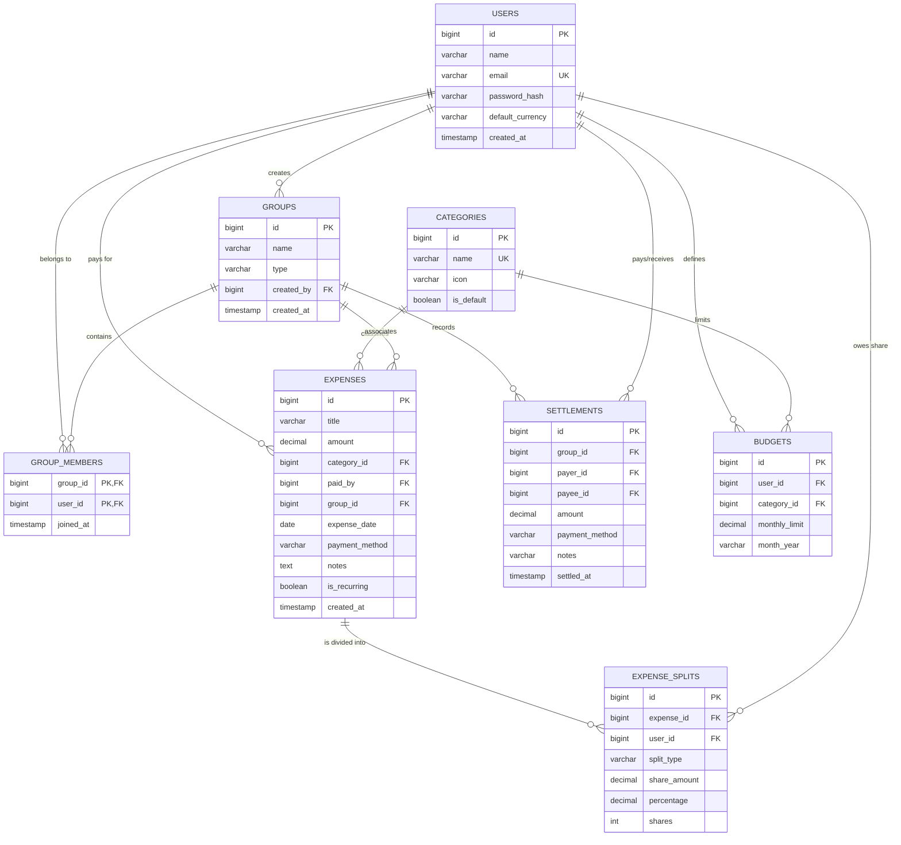
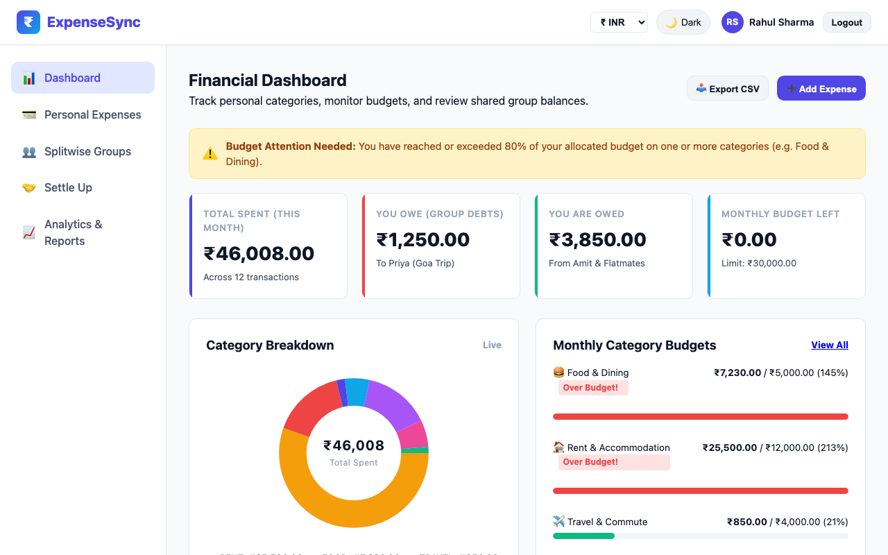
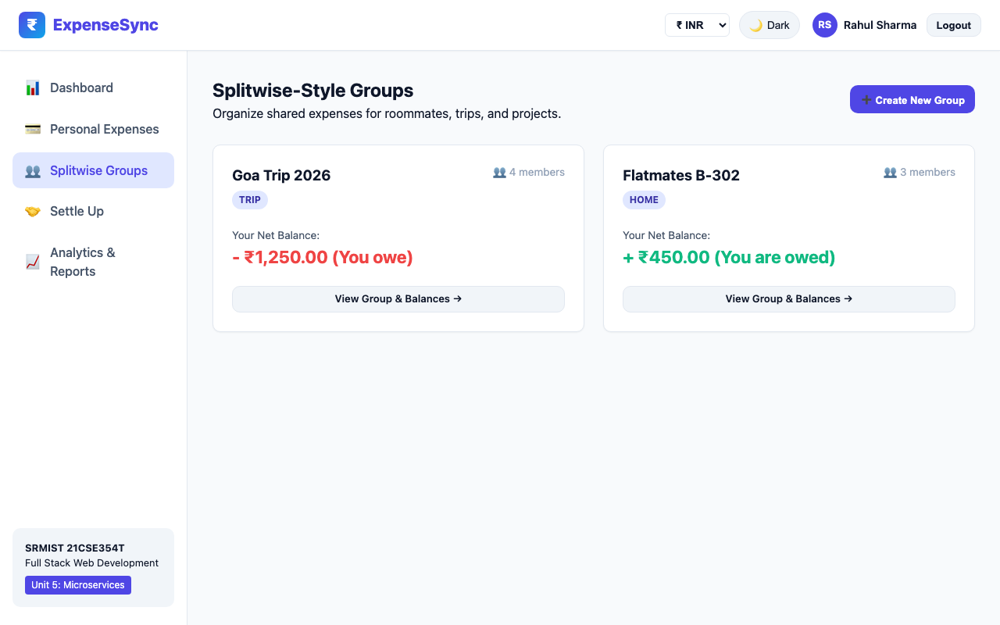
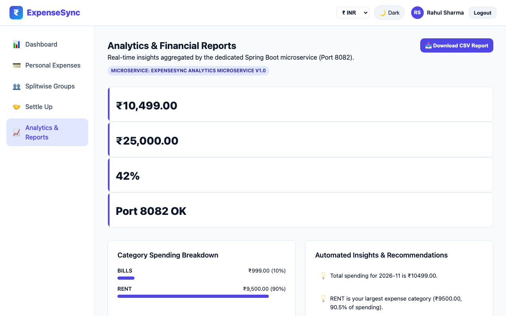

# ExpenseSync: Expense Management System with Splitwise-Style Bill Splitting

[](https://www.srmist.edu.in/)
[](https://www.srmist.edu.in/)
[](https://github.com/)
[](LICENSE)

> A modern full-stack web application combining **Personal Expense Tracking** (budgets, category spending limits, overspend warnings, CSV reporting) with **Collaborative Bill Splitting** (groups, 4 split models, and greedy minimum-cash-flow debt simplification).

---

## 1. Project Overview & Architecture

ExpenseSync is designed following the 5-unit curriculum of **21CSE354T Full Stack Web Development (SRMIST)**. The repository is organized unit-wise, allowing evaluators to run, inspect, and grade each unit independently while also providing a unified production-ready microservices build in `final-project/`.

### System Architecture Diagram
```mermaid
flowchart TD
    subgraph Client Tier [Client Tier - React + Vite (Port 5173)]
        UI[Single Page Application<br>React Router, Axios, ThemeContext, AuthContext]
        DOM[DOM / Canvas 2D Charts]
    end

    subgraph Core Service [Core Service (Spring Boot - Port 8080)]
        direction TB
        SEC[Spring Security &amp; JwtAuthenticationFilter]
        CTRL[REST Controllers<br>ExpenseController, GroupController, AuthController]
        SERV[Service Layer<br>SplitCalculationService, DebtSimplificationService]
        REPO[Spring Data JPA Repositories]
    end

    subgraph Analytics Microservice [Analytics Microservice (Spring Boot - Port 8082)]
        ACTRL[AnalyticsController]
        ASERV[AnalyticsService<br>Monthly Reports &amp; CSV Streaming]
    end

    subgraph Data Tier [Persistence Tier]
        MYSQL[("MySQL 8.0 / H2 Database<br>Relational Schema with 8 Tables")]
    end

    UI -->|HTTP Requests + Bearer JWT| SEC
    SEC --> CTRL
    CTRL --> SERV
    SERV --> REPO
    REPO -->|JDBC / Hibernate| MYSQL
    SERV -->|"Inter-Service REST Call<br>(RestTemplate /api/analytics)"| ACTRL
    ACTRL --> ASERV
```

### Entity-Relationship (ER) Diagram


---

## 2. Visual Walkthrough & System Screenshots

| View | Screenshot | Description |
| :--- | :--- | :--- |
| **Financial Dashboard** |  | Personal budget meters, spending summary cards, category donut chart, and 80% caution alerts |
| **Splitwise Bill Splitting** |  | Group expense feed, live 4-method split preview, and greedy minimum-cash-flow simplified debts |
| **Microservice Analytics** |  | Dedicated microservice (`analytics-service`: 8082) monthly spending breakdown and insights |
| **Mobile Responsive UI** |  | High-contrast, touch-optimized responsive layout tested across mobile viewports (375px) |

---

## 3. Syllabus Mapping (21CSE354T Full Stack Web Development)

| Unit | Syllabus Module & Hours | Project Component | Path | Key Concepts Demonstrated |
| :--- | :--- | :--- | :--- | :--- |
| **Unit 1** | **HTML5 & CSS3** (9 Hours) | Static Multi-Page Site | [`unit-1/`](unit-1/README.md) | Semantic tags, validation, Flexbox, Grid, keyframe animations, Canvas 2D donut chart, dark/light CSS variables. |
| **Unit 2** | **JavaScript & React JS** (9 Hours) | Dynamic Client Apps | [`unit-2/`](unit-2/README.md) | **Part A**: Vanilla JS DOM, ES6 array methods, 4 split algorithms with paise rounding, Canvas Confetti.<br>**Part B**: React 18 SPA (Vite), custom hooks (`useExpenses`, `useDebounce`) with `useDebugValue`, Context API (`ThemeContext`, `AuthContext`), budget progress meters. |
| **Unit 3** | **SQL & JDBC** (9 Hours) | Relational DB & CLI | [`unit-3/`](unit-3/README.md) | 8-table relational schema (`schema.sql`), seed data (`seed.sql`), multi-table joins, subqueries ("Who Owes Whom"), `UNION/INTERSECT/EXCEPT`, and Java 17 JDBC CLI (`PreparedStatement`, `ResultSet`, connection pooling). |
| **Unit 4** | **Spring Boot Part 1** (9 Hours) | Layered REST API | [`unit-4/`](unit-4/README.md) | Controller $\rightarrow$ Service $\rightarrow$ Repository architecture, DTOs, Jakarta Bean Validation, `@RestControllerAdvice`, Greedy Minimum-Cash-Flow Algorithm, JUnit 5 test suite (6 test cases), Postman collection. |
| **Unit 5** | **Spring Boot Part 2 & Microservices** (9 Hours) | Full Stack & Microservices | [`unit-5/`](unit-5/README.md) | Spring Data JPA (MySQL & H2 profiles), stateless JWT authentication (HMAC-SHA256, BCrypt), dedicated Analytics microservice (port 8082), inter-service `RestTemplate` calls, connected React client with Axios. |
| **Final** | **Consolidated Capstone** | Production Stack | [`final-project/`](final-project/) | Unified Docker Compose deployment (`mysql-db`, `core-service`, `analytics-service`, `frontend`). |
| **Docs** | **Engineering Artifacts** | Formal Documentation | [`docs/`](docs/) | SRS, Mermaid Architecture & ER diagrams, API Docs, Postman collection, College Project Report outline. |

---

## 4. Core Features Breakdown

### A. User & Authentication
* Multi-user registration with validation (valid email, 8+ character password, unique constraint).
* BCrypt password hashing.
* Stateless JSON Web Token (JWT) issuing and client-side storage with auto-logout handling on expiry.
* Multi-currency support (INR ₹ default, USD $, EUR €).

### B. Personal Expense Tracker
* Full CRUD (Create, Read, Update, Delete) for personal expenses with title, amount, category, date, and payment method (UPI, Card, Cash, Bank).
* Standard categories (Food, Travel, Rent, Shopping, Bills, Entertainment, Health, Other) + custom categories.
* Recurring expense flagging (Monthly rent, Netflix, WiFi bill).
* Debounced search, category filter, payment method filter, date/amount sorting, pagination, and CSV export.

### C. Category Budgets & Warnings
* Monthly budget limits set per category and an overall monthly limit.
* Dynamic visual progress meters.
* **80% Caution Alert**: Amber alert when category spending reaches 80% threshold.
* **100% Over-Budget Alert**: Red alert banner preventing inadvertent overspending.

### D. Group Expenses & 4 Splitwise Split Types
* Create groups (Trip, Home, Couple, Other) and add members via email.
* Group expense feed with date, payer, and category.
* **4 Split Methods**:
  1. **Equal Split**: Divided equally among selected members.
  2. **Exact Amounts**: Explicit currency inputs summing to total bill.
  3. **Percentages**: Percentage shares summing to exactly 100%.
  4. **Shares (Ratio)**: Integer ratios (e.g. 2:1:1:1).
* **Paise/Cent Rounding Absorption**: Fractional remainders are absorbed automatically by the last member so sum of shares matches total bill with mathematical precision.

### E. Greedy Debt Simplification & Settle-Up
* Implements the **Greedy Minimum-Cash-Flow Algorithm** to minimize total settlement transactions across large groups with circular debts.
* **Settle Up**: Record payments between two members (full or partial) with instant net balance recalculation and historical settlement logs.

---

## 5. REST API Endpoints Overview

| Method | Endpoint | Description | Service | Port |
| :--- | :--- | :--- | :--- | :--- |
| `POST` | `/api/auth/register` | Register new user and receive JWT | Core | 8080 |
| `POST` | `/api/auth/login` | Authenticate user and receive JWT | Core | 8080 |
| `GET` | `/api/auth/me` | Fetch authenticated user profile | Core | 8080 |
| `GET` | `/api/expenses` | List, search, and filter personal/group expenses | Core | 8080 |
| `POST` | `/api/expenses` | Add expense (personal or group with split) | Core | 8080 |
| `PUT` | `/api/expenses/{id}` | Update existing expense | Core | 8080 |
| `DELETE` | `/api/expenses/{id}`| Delete expense | Core | 8080 |
| `GET` | `/api/groups` | List all groups and member net balances | Core | 8080 |
| `GET` | `/api/groups/{id}/simplified-debts` | Compute minimum cash flow transfers | Core | 8080 |
| `POST` | `/api/settlements` | Record debt settlement payment | Core | 8080 |
| `GET` | `/api/reports/analytics` | Inter-service proxy call for analytics | Core | 8080 |
| `GET` | `/api/analytics/summary` | Generate monthly report & spending breakdown | Analytics | 8082 |
| `GET` | `/api/analytics/export-csv` | Stream CSV report download | Analytics | 8082 |

---

## 6. Environment Setup & Prerequisites

### Required Tooling
* **Java**: JDK 17 or higher
* **Build Tool**: Apache Maven 3.8+
* **Node.js**: Node 18+ and npm 9+
* **Database**: MySQL 8.0+ (Optional; automated in-memory H2 profile included for zero-setup execution)
* **Git**: Version 2.30+

### Installation Commands by Operating System

#### macOS (Homebrew)
```bash
# 1. Install Java 17+ and Maven
brew install openjdk@17 maven
sudo ln -sfn /opt/homebrew/opt/openjdk@17/libexec/openjdk.jdk /Library/Java/JavaVirtualMachines/openjdk-17.jdk

# 2. Install Node.js (LTS)
brew install node

# 3. (Optional) Install MySQL
brew install mysql
brew services start mysql
```

#### Ubuntu / Debian Linux
```bash
# 1. Install Java 17 and Maven
sudo apt update
sudo apt install -y openjdk-17-jdk maven

# 2. Install Node.js 18+
curl -fsSL https://deb.nodesource.com/setup_20.x | sudo -E bash -
sudo apt install -y nodejs

# 3. (Optional) Install MySQL
sudo apt install -y mysql-server
sudo systemctl start mysql
```

#### Windows (PowerShell with Winget / Chocolatey)
```powershell
# Using Winget
winget install EclipseAdoptium.Temurin.17.JDK
winget install Apache.Maven
winget install OpenJS.NodeJS.LTS
winget install Oracle.MySQL
```

---

## 7. Quick Start Guide

### Running Unit by Unit

#### Unit 1: HTML5 & CSS3
```bash
cd unit-1
open index.html
# Or: python3 -m http.server 3000
```

#### Unit 2: JavaScript & React JS
```bash
# Part A: Vanilla JS Split Calculator
cd unit-2/part-a-vanilla-js
open index.html

# Part B: React Application
cd ../part-b-react
npm install
npm run dev
```

#### Unit 3: SQL & JDBC Console App
```bash
cd unit-3/jdbc-app
mvn clean compile exec:java
```

#### Unit 4: Spring Boot Layered REST API & JUnit 5 Tests
```bash
cd unit-4
mvn clean test             # Run 6 automated test cases
mvn spring-boot:run        # Start REST API on port 8080
```

#### Unit 5: JPA Core Service + Microservice + Connected React Client
```bash
# Terminal 1: Analytics Microservice
cd unit-5/analytics-service
mvn spring-boot:run

# Terminal 2: Core Service
cd unit-5/core-service
mvn spring-boot:run

# Terminal 3: React Client
cd unit-5/client
npm install
npm run dev
```

---

### Running via Docker Compose (Unified Production Stack)
```bash
cd final-project
docker-compose up --build
```
* **Frontend**: `http://localhost:5173`
* **Core API**: `http://localhost:8080`
* **Analytics Microservice**: `http://localhost:8082`
* **MySQL Database**: `localhost:3306`

---

## 8. 3-Minute Examiner Demo Script

Follow this sequential walkthrough during the laboratory viva or project evaluation:

```text
[0:00 - 0:45] Minute 1: Authentication & Personal Budgeting
1. Open http://localhost:5173 and log in with demo credentials:
   Email: rahul@example.com | Password: Password@123
2. Point out the Financial Overview dashboard:
   - 4 Metric cards (Total Monthly Spent: ₹19,000.00, Budget Limit: ₹25,000.00, Budget Used: 76.0%).
   - Category meters: Food (₹4,200 / ₹5,000 at 84% amber caution), Rent (₹9,500 / ₹12,000 at 79%).
   - Live Category Donut chart and 6-month spending trends.
3. Toggle the 🌙 Dark / ☀️ Light mode button in the navbar to demonstrate CSS variable transitions.

[0:45 - 1:45] Minute 2: Splitwise Groups & 4 Split Types
4. Navigate to "Splitwise Groups" -> click into "Goa Trip 2026":
   - Highlight the "Greedy Min-Cash-Flow Simplification Active" banner.
   - Show how the seeded group expenses (Swiggy ₹1,450, Uber ₹850, Villa ₹16,000) are resolved into direct simplified debts:
     • Rahul owes Priya ₹2,275.00
     • Amit owes Priya ₹4,575.00
     • Sneha owes Priya ₹4,575.00
     (Net group balances sum to exactly ₹0.00).
5. Click "➕ Add Expense" -> enter "Highway Dhaba Dinner", Amount "₹2,400":
   - Select Split Type: EQUAL, EXACT, PERCENTAGE, or SHARES (e.g. 2:2:1:1).
   - Show the Live Split Preview box dynamically updating each participant's share as you type.
   - Demonstrate the rounding absorption feature (e.g. ₹100 split 3 ways yields ₹33.33, ₹33.33, and ₹33.34 to guarantee exact conservation of currency).

[1:45 - 2:30] Minute 3: Settle-Up & Microservices Architecture
6. Click "🤝 Settle Up" -> select "Rahul pays Priya ₹1,000 via UPI" -> click Save:
   - Show Rahul's debt dynamically decrease from ₹2,275.00 down to ₹1,275.00, updating the simplified settlement chain in real time.
7. Demonstrate Microservices Architecture in terminal or browser:
   - Call http://localhost:8080/api/reports/analytics?userId=1 with JWT Bearer token.
   - Point out in console logs that Core Service (8080) made a synchronous REST call via RestTemplate to the separate Analytics Microservice (8082).
8. Click "📥 Export CSV" (or fetch GET http://localhost:8080/api/reports/export-csv) to stream the finalized expense ledger.

[2:30 - 3:00] Wrap-up & Viva Q&A
- Show the passing JUnit 5 tests (mvn test in unit-4) verifying greedy simplification edge cases (circular debts, uneven splits, rounding absorption).
- Answer examiner questions from the Viva Q&A sections in the unit READMEs.
```

---

## 9. Seed Demo Credentials

| Role | Name | Email | Password |
| :--- | :--- | :--- | :--- |
| **Primary User** | Rahul Sharma | `rahul@example.com` | `Password@123` |
| **Member 2** | Priya Nair | `priya@example.com` | `Password@123` |
| **Member 3** | Amit Patel | `amit@example.com` | `Password@123` |
| **Member 4** | Sneha Rao | `sneha@example.com` | `Password@123` |

---

## 10. Known Technical Limitations & Honest Disclosures

In the spirit of rigorous academic engineering, the following limitations are noted:
1. **Microservice Service Discovery**: Services currently communicate via configured host/port URIs (`http://localhost:8082`). An enterprise Netflix Eureka discovery server or Spring Cloud Consul was omitted to keep the college lab build lightweight and avoid excessive memory overhead.
2. **Offline Payment Gateway**: Settle-up payments record ledger transactions (UPI, Cash, Bank Transfer) but do not execute live banking transactions via real payment gateways (such as Razorpay or Stripe) since this is an educational mock application.
3. **Receipt Storage**: File attachments for receipts are stored in the database metadata; cloud bucket object storage (e.g. AWS S3 or Google Cloud Storage) is marked for future scope.

---

## 11. Future Scope
* **OCR Receipt Scanner**: Automated expense digitization using Google Cloud Vision API.
* **WebSocket Live Feed**: Real-time push updates for instant group settlement notifications.
* **Native UPI Deep-Linking**: Integration with `upi://pay` URI schemes for immediate mobile banking app settlement.

---

## 12. License & Academic Attribution
Developed as an academic capstone submission for **21CSE354T Full Stack Web Development** at **SRM Institute of Science and Technology**. Released under the [MIT License](LICENSE).

