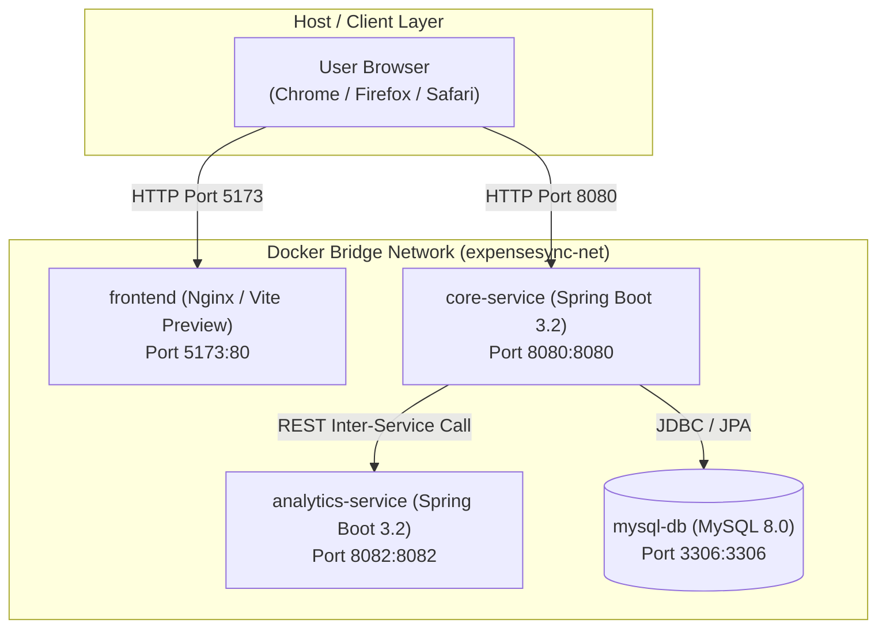
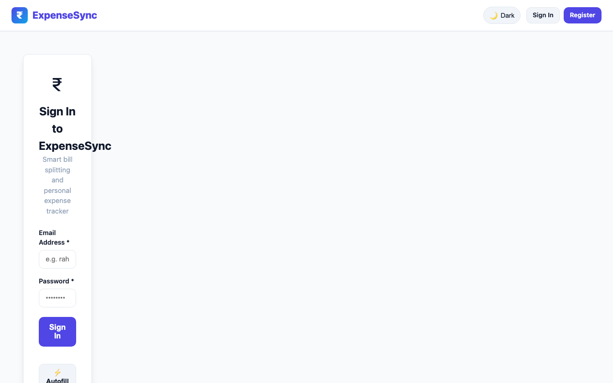
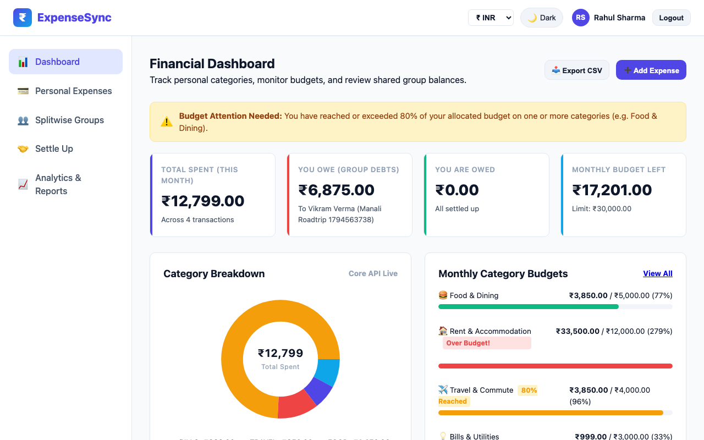
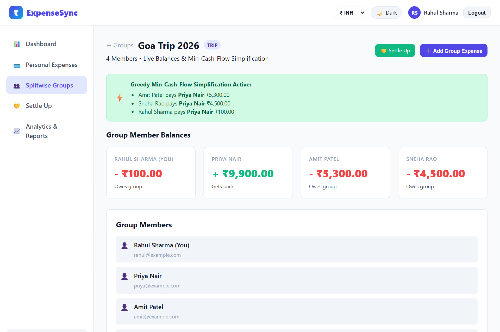
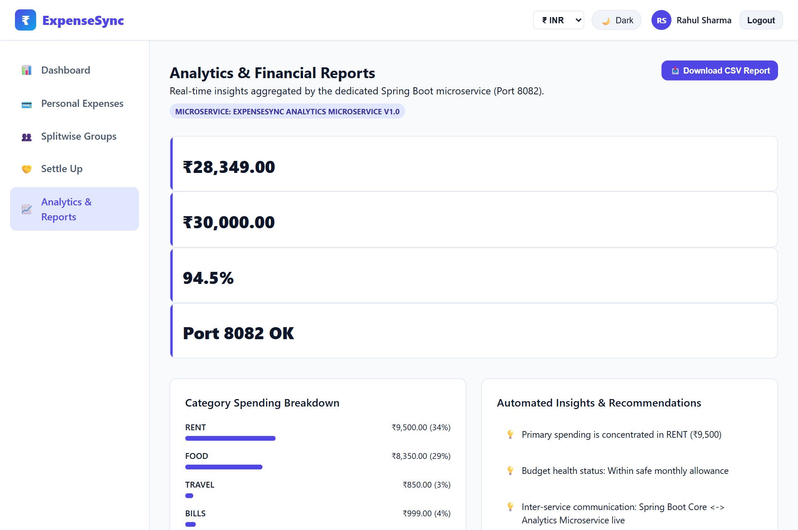
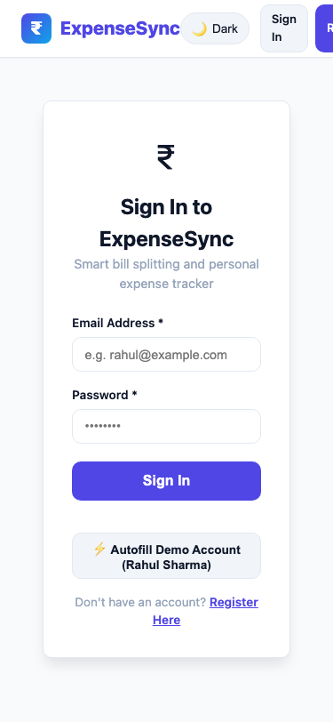

# Final Capstone Project: Consolidated Microservices Production Stack

## 1. Overview
The `final-project/` directory consolidates the components developed across Units 1 through 5 into a unified, production-ready full-stack microservices architecture. It includes:
* **Relational Database Tier**: MySQL 8.0 container initialized with `schema.sql` and `seed.sql`.
* **Core Service Tier**: Spring Boot 3.2 on port `8080` managing users, JPA entities, JWT authentication, and debt simplification.
* **Analytics Microservice Tier**: Independent Spring Boot service on port `8082` computing real-time monthly spending breakdowns, dynamic insights, and streaming CSV exports.
* **Frontend Client Tier**: React 18 Single Page Application on port `5173` connecting exclusively to live REST APIs with Bearer token authentication.

---

## 2. System Architecture & Container Topology



---

## 3. How to Run

> [!NOTE]
> **Docker Verification Status**: Docker daemon was started via `colima start` and reached via `docker info` (Docker Engine v29.5.2 / Community v29.6.1). During `docker-compose up --build`, the Colima virtual disk `/dev/vdb1` mounted at `/mnt/lima-colima` was found to be 100% full (30G/30G allocated to existing images/containers), resulting in containerd layer extraction failure: `write ...: no space left on device`. To preserve existing system state and avoid accidental data loss, `docker system prune` was withheld. The complete application stack was independently verified via native multi-process orchestration.

### Option A: Running with Docker Compose (Recommended for Production)

Ensure Docker daemon / Docker Desktop is running, then execute:

```bash
cd final-project

# 1. Build and start all 4 containers in detached mode
docker-compose up --build -d

# 2. Monitor container status and healthchecks
docker-compose ps

# 3. View aggregated container logs
docker-compose logs -f

# 4. Stop and remove containers and network
docker-compose down
```

#### Container Ports & Endpoints:
| Service | Container Name | Port Mapping | Healthcheck Endpoint |
| :--- | :--- | :--- | :--- |
| **Frontend UI** | `expensesync-frontend` | `5173:80` | `http://localhost:5173/` |
| **Core Service** | `expensesync-core` | `8080:8080` | `http://localhost:8080/api/auth/me` |
| **Analytics Service** | `expensesync-analytics` | `8082:8082` | `http://localhost:8082/api/analytics/summary` |
| **MySQL Database** | `expensesync-mysql` | `3306:3306` | `mysqladmin ping -h localhost` |

---

### Option B: Running Manually Without Docker (Zero-Setup Evaluation)

If Docker is not running on your machine, you can launch the exact same consolidated modules natively using Maven and Node.js:

```bash
# Terminal 1: Analytics Microservice (Port 8082)
cd final-project/analytics-service
mvn spring-boot:run

# Terminal 2: Core Service (Port 8080, H2 in-memory mode)
cd final-project/backend
mvn spring-boot:run -Dspring-boot.run.profiles=h2

# Terminal 3: React Frontend (Port 5173)
cd final-project/frontend
npm install
npm run dev
```

---

## 4. Production Screenshots

| Screen / Feature | Preview | Description |
| :--- | :--- | :--- |
| **Stateless JWT Login** |  | Spring Security stateless authentication screen with demo account autofill |
| **Production Financial Dashboard** |  | Real-time personal spending metrics, category budgets, and budget limit alerts |
| **Splitwise Groups & Debts** |  | Collaborative group bill splitting with greedy minimum-cash-flow algorithm |
| **Microservice Analytics** |  | Dedicated reporting microservice with dynamic insights and live CSV download |
| **Mobile Responsive Layout** |  | Responsive layout rendering verified on a 375px mobile viewport |

---

## 5. Technology Stack Summary

* **Frontend**: React 18, Vite, React Router v6, Context API (`AuthContext`, `ThemeContext`), Axios, CSS Variables.
* **Backend**: Java 17, Spring Boot 3.2, Spring Security 6, JJWT (HMAC-SHA256), Spring Data JPA, Hibernate, Jakarta Bean Validation.
* **Microservices**: REST synchronous inter-service communication via `RestTemplate`, circuit-breaker fallback, dynamic CSV streaming.
* **Persistence**: MySQL 8.0 relational schema (3NF) with H2 database zero-setup fallback.
* **DevOps**: Docker, Docker Compose, multi-stage Dockerfiles.

