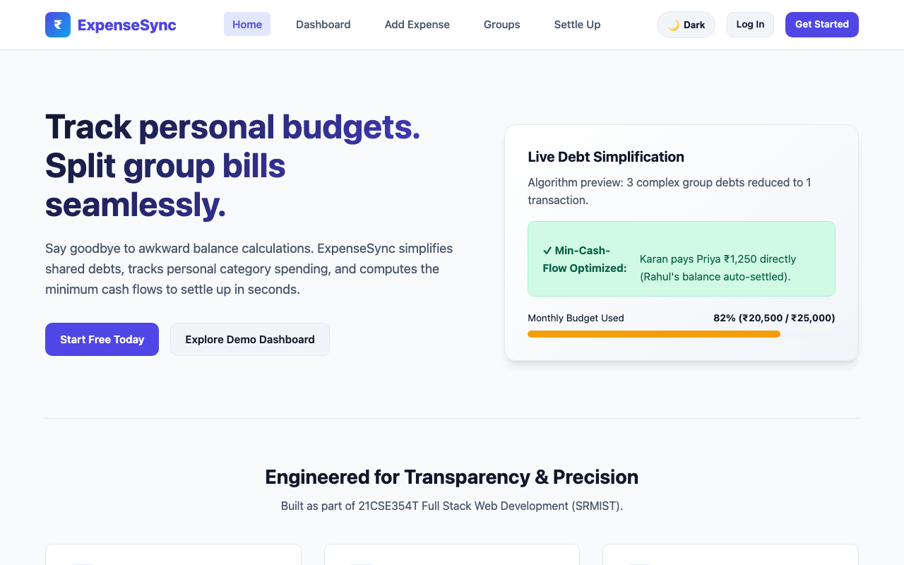
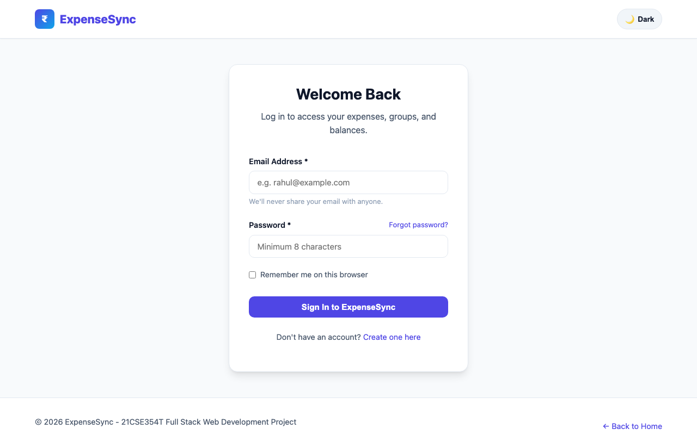
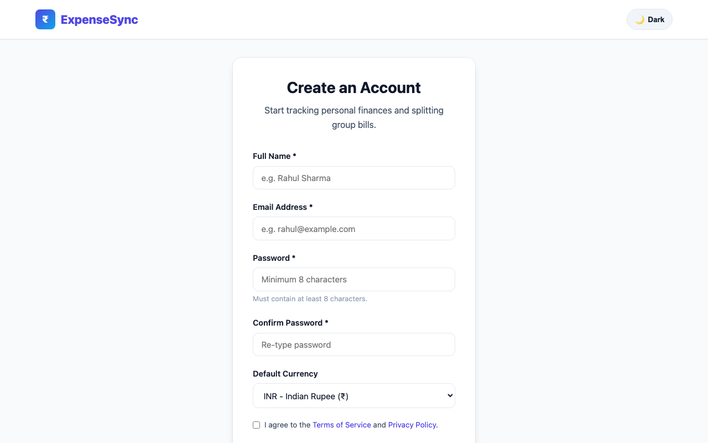
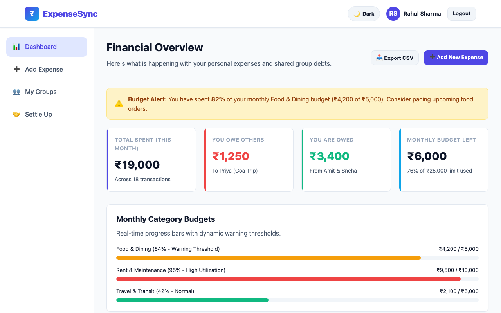
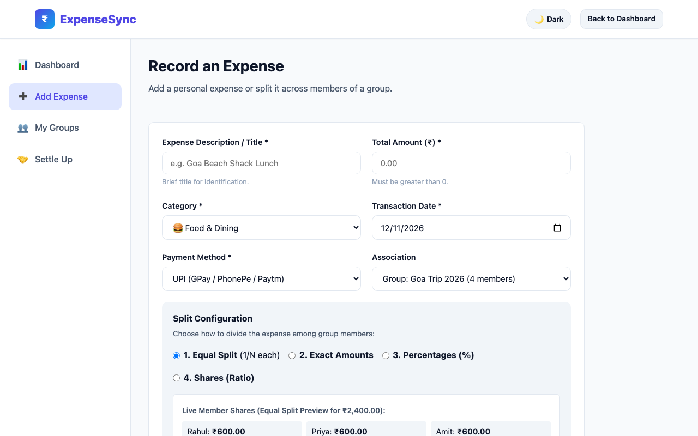
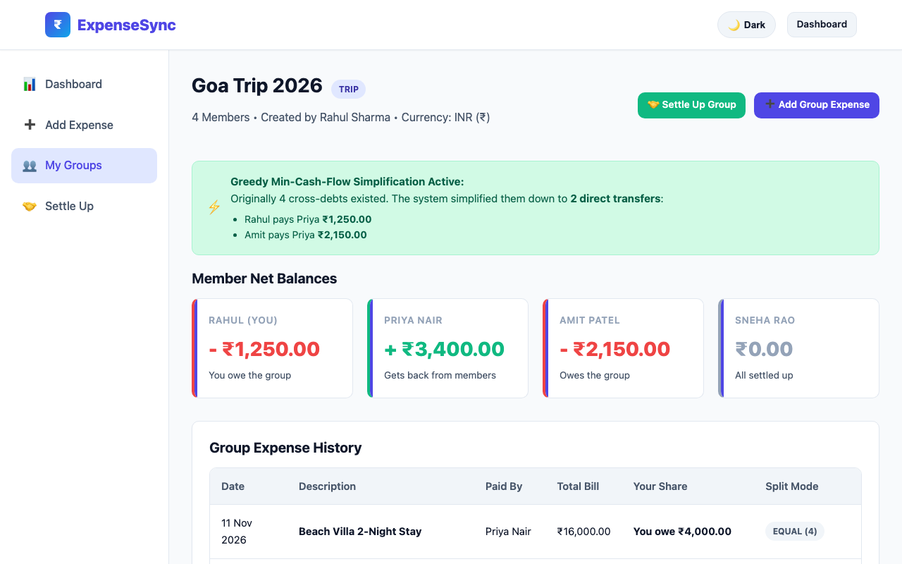
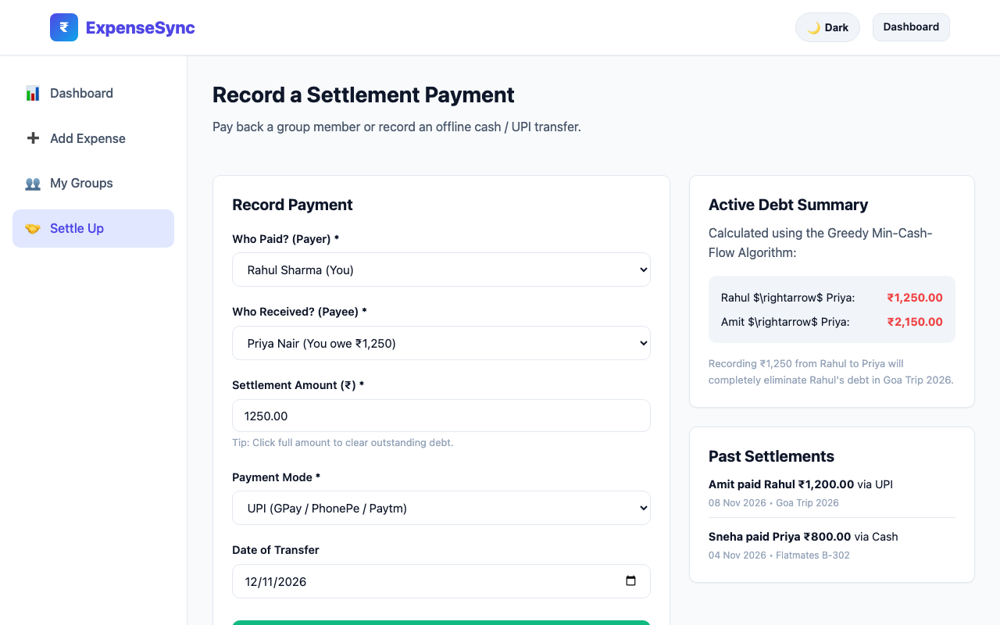
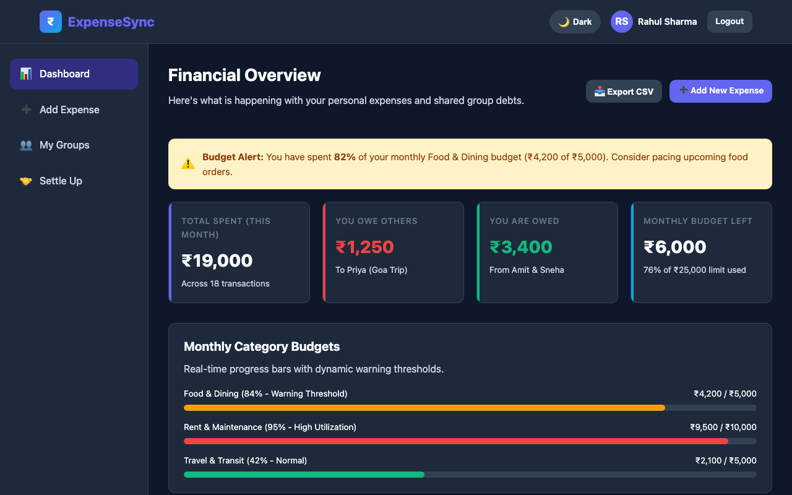
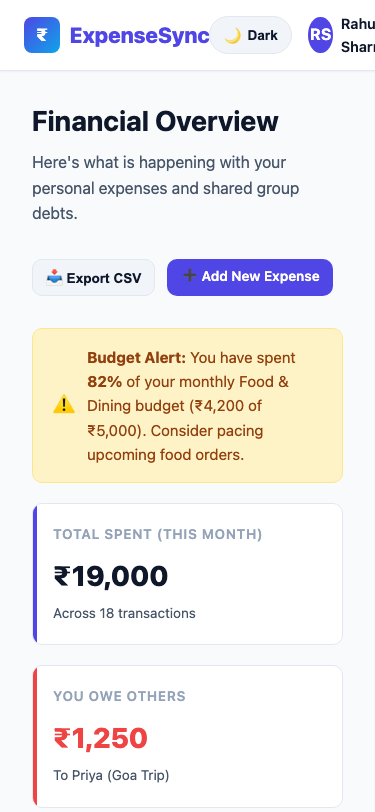

# Unit 1: HTML5 & CSS3 Foundation — ExpenseSync

## 1. Aim
To design and build a responsive, accessible, multi-page static web application frontend for **ExpenseSync** (an Expense Management & Splitwise-style Bill Splitting system) demonstrating core HTML5 semantic structures, form validation, CSS box modeling, Flexbox and Grid layouts, transitions/animations, and HTML5 2D Canvas charting.

---

## 2. Syllabus Concepts Covered (21CSE354T)
* **HTML Document Structure & Semantics**: Use of `<header>`, `<nav>`, `<main>`, `<section>`, `<article>`, `<aside>`, `<footer>`, `<figure>`, and structured tables (`<thead>`, `<tbody>`).
* **HTML5 Form Validation**: Required attributes, input types (`email`, `password`, `number`, `date`, `radio`, `checkbox`), length constraints (`minlength="8"`), number steps (`step="0.01"`), and `:user-invalid` pseudo-class styling.
* **CSS Typography & Box Model**: Margins, paddings, border-box calculations, border-radius, shadows, and custom CSS Variables (`:root` and `[data-theme="dark"]`).
* **Modern CSS Layouts**: 
  * **Flexbox**: Responsive navigation bars, header alignment, action trays, and button groups.
  * **CSS Grid**: Dashboard summary metrics grid (`repeat(auto-fit, minmax(...))`), 2-column form layouts, and application shell layout (sidebar + main content).
* **Transitions & Animations**: `@keyframes fadeIn`, `@keyframes slideInUp`, `@keyframes pulseGlow` for overspend alerts, and GPU-accelerated hover transformations (`translateY(-4px)`).
* **HTML5 Canvas 2D API**: Dynamic rendering of category expense donut charts and monthly spending bar charts without third-party dependencies.
* **Accessibility & User Preferences**: Respects `prefers-reduced-motion` for motion-sensitive users and persistent light/dark themes stored in `localStorage`.

---

## 3. What Was Built
1. `index.html`: Marketing landing page introducing ExpenseSync with hero card, feature cards, and min-cash-flow algorithm teaser.
2. `login.html`: Secure authentication interface with email and password validation.
3. `register.html`: Registration form collecting full name, email, password confirmation, and default currency selection.
4. `dashboard.html`: Complete financial hub featuring:
   * 4 metric cards (Total Spent, You Owe, You Are Owed, Budget Left).
   * 80% caution warning alert and 100% budget utilization meter.
   * HTML5 Canvas Category Donut Chart and 6-Month Spending Bar Chart.
   * Filterable Recent Transactions Table with status badges.
5. `add-expense.html`: Multi-input expense form supporting:
   * Title, amount, category, date, and payment mode (UPI, Cash, Card, Bank).
   * 4 split configurations: Equal, Exact, Percentage, and Shares.
   * Live preview box demonstrating paise/cent rounding absorption.
6. `group.html`: Group workspace ("Goa Trip 2026") showing member net balances, greedy simplification notification, and expense timeline feed.
7. `settle-up.html`: Settlement recording interface with payer/payee selectors, debt clearing suggestions, and historical settlement feed.
8. `css/`: Modular stylesheets (`style.css`, `layout.css`, `animations.css`).
9. `js/canvas-chart.js`: Lightweight JavaScript file for 2D Canvas charts and dark/light mode toggle.

---

## 4. How to Run
Unit 1 consists of pure static web assets and requires no build step.

### Option A: Using any static server (Node.js)
```bash
# Navigate to unit-1 directory
cd unit-1

# Serve using npx serve or python http.server
npx serve .
# Or:
python3 -m http.server 3000
```
Open your browser at `http://localhost:3000` or the port printed in the terminal.

### Option B: Directly open in browser
Double-click `index.html` or open it with Google Chrome / Firefox / Safari:
```bash
open index.html
```

---

## 5. Sample Output & User Flow
* **Landing (`index.html`)**: Features responsive hero section and navigation to either Login or the Interactive Demo Dashboard.
* **Dashboard (`dashboard.html`)**: Displays category breakdown on a custom Canvas donut chart (Food, Rent, Travel, Bills, Entertainment) and highlights an overspend caution when category usage exceeds 80%.
* **Dark Mode**: Clicking the **🌙 Dark / ☀️ Light** button toggles CSS variables seamlessly and repaints the Canvas charts with theme-aware text colors.

---

## 6. Screenshots

| Page / State | Preview | Caption |
| :--- | :--- | :--- |
| **Landing Page** |  | Responsive landing page with features overview and navigation |
| **Login Page** |  | Form-validated authentication screen |
| **Register Page** |  | New user onboarding with currency preference selector |
| **Dashboard** |  | Metric cards, Canvas donut chart, and 80% category budget warning |
| **Add Expense** |  | Expense logging form with payment method and category selection |
| **Group Page** |  | Group feed with member balances and activity log |
| **Settle Up** |  | Payment recording interface with settlement history |
| **Dark Mode** |  | Seamless theme transition via CSS custom properties |
| **Mobile Layout** |  | Responsive mobile view rendered at 375px width |

---

## 7. Assumptions
* **Currency**: The primary default currency is Indian Rupee (INR - ₹).
* **Scope**: Unit 1 focuses strictly on static HTML5 semantic layout and CSS styling; no client-side JavaScript calculation frameworks or backend servers are used.
* **Canvas Charting**: HTML5 2D Canvas is used for zero-dependency charting instead of external SVG/Chart.js libraries.
* **Storage**: Theme preferences (`light`/`dark`) are persisted client-side via `localStorage`.

---

## 8. Viva Q&A (5 Key Questions)

### Q1: What is the CSS Box Model, and why is `box-sizing: border-box;` considered a best practice?
**Answer:** The CSS Box Model comprises four concentric rectangular layers around every element: **Content**, **Padding**, **Border**, and **Margin**. By default (`box-sizing: content-box`), padding and borders add to the specified width and height, causing unexpected layout overflows. Setting `box-sizing: border-box` includes padding and borders inside the declared width/height, making responsive layouts predictable and easier to calculate.

### Q2: How does CSS Flexbox differ from CSS Grid, and where is each used in this project?
**Answer:** 
* **Flexbox (1D)**: Operates along a single dimension (row or column). In this project, Flexbox aligns elements inside navigation bars (`.nav-container`), button groups, and form field rows.
* **CSS Grid (2D)**: Operates simultaneously across rows and columns. In this project, Grid structures the overall dashboard (`.app-layout` with sidebar + main content), the 4-column metric summary cards (`.stat-grid`), and the 2-column input forms (`.form-row`).

### Q3: How does the HTML5 Canvas API work for data visualization compared to SVG?
**Answer:** HTML5 Canvas provides an immediate-mode bitmap drawing surface manipulated through JavaScript (`canvas.getContext('2d')`). Pixels are rasterized directly and do not populate the DOM, making it performant and memory-efficient for lightweight charts. In contrast, SVG is retained-mode vector graphics with XML DOM nodes for each shape. In Unit 1, Canvas is used to draw the pie slices (`ctx.arc`, `ctx.fill`) and trend bars (`ctx.roundRect`).

### Q4: How is dark mode implemented without JavaScript styling libraries?
**Answer:** By defining design tokens as custom properties (CSS Variables) inside `:root` (for default light mode) and overriding those values under a `[data-theme="dark"]` attribute selector. A lightweight JavaScript function toggles the `data-theme` attribute on `document.documentElement` and persists the state in `localStorage`.

### Q5: What HTML5 form validation attributes are utilized, and how does the browser enforce them?
**Answer:** Attributes used include `required`, `type="email"`, `type="number"`, `minlength="8"`, `step="0.01"`, and `min="1"`. The browser enforces constraint validation natively before form dispatch, preventing submission if fields are invalid and exposing pseudo-classes such as `:invalid` and `:user-invalid` for visual feedback.

