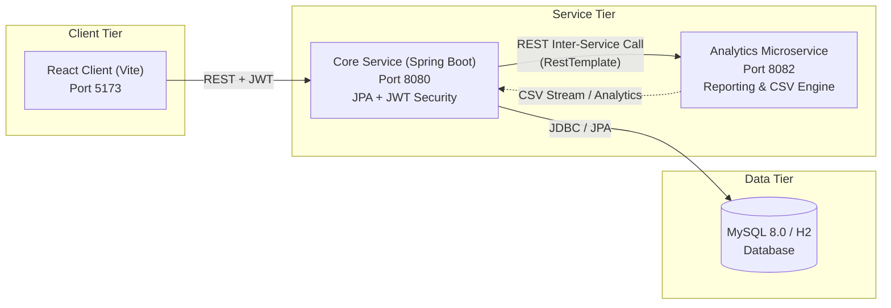

# Unit 5: Spring Boot Part 2 & Microservices — ExpenseSync

## 1. Aim
To elevate **ExpenseSync** from a monolithic structure to a distributed **Microservices Architecture**. This unit integrates **Spring Data JPA** for ORM persistence (MySQL with H2 fallback), implements **Spring Security with stateless JWT authentication**, extracts a standalone **Analytics & Reporting Microservice** (`analytics-service`), demonstrates inter-service REST communication via `RestTemplate`, and connects the React frontend (`client`) with live APIs and CSV reporting.

---

## 2. Syllabus Concepts Covered (21CSE354T)
* **Spring Data JPA & Hibernate ORM**:
  * Relational entity mapping (`@Entity`, `@Table`, `@Id`, `@GeneratedValue`).
  * Associations: `@ManyToOne`, `@OneToMany`, `@ManyToMany` with `@JoinTable` and cascading behaviors.
  * Derived query methods and custom `@Query` (JPQL) for aggregations.
* **Spring Security & Stateless JWT Authentication**:
  * Decoupled stateless authentication with `JwtAuthenticationFilter` extending `OncePerRequestFilter`.
  * Cryptographic signing via HMAC-SHA256 (`io.jsonwebtoken.security.Keys`).
  * Passwords hashed using `BCryptPasswordEncoder` (10 rounds with per-user salt).
  * Role-based and path-based endpoint access control with CORS configuration.
* **Microservices Architecture**:
  * Decomposition of monolithic services into bounded contexts (`core-service` and `analytics-service`).
  * Autonomous deployments: `core-service` on port `8080`, `analytics-service` on port `8082`.
  * Synchronous inter-service REST communication via Spring's `RestTemplate` with connection/read timeouts and circuit-breaker fallback.
* **Full Stack Client-Server Integration**:
  * Axios HTTP client with request interceptors injecting `Authorization: Bearer <token>` and response interceptors handling session expiry.

---

## 3. Microservice Architecture Diagram



---

## 4. What Was Built
```text
unit-5/
├── core-service/                              # Main backend (Port 8080)
│   ├── pom.xml                                # Web, JPA, Security, JWT, MySQL, H2
│   ├── src/main/java/com/expensesync/core/
│   │   ├── CoreServiceApplication.java
│   │   ├── config/DataInitializer.java        # Auto-seeds 4 users, 2 groups, expenses
│   │   ├── entity/                            # User, Group, Category, Expense, ExpenseSplit, Settlement, Budget
│   │   ├── repository/                        # Spring Data JPA Repositories
│   │   ├── security/                          # JwtUtils, JwtAuthenticationFilter, SecurityConfig
│   │   ├── service/                           # AuthService, CoreExpenseService, AnalyticsClientService
│   │   ├── controller/                        # AuthController, ExpenseController, ReportsController
│   │   └── dto/AuthDTOs.java                  # Register, Login, Token payloads
│   └── src/main/resources/
│       ├── application.properties             # Active profile: h2 (default for evaluation)
│       └── application-mysql.properties       # Profile: mysql (for MySQL daemon)
├── analytics-service/                         # Microservice (Port 8082)
│   ├── pom.xml                                # Web, Test
│   └── src/main/java/com/expensesync/analytics/
│       ├── AnalyticsServiceApplication.java
│       ├── controller/AnalyticsController.java # /api/analytics/summary & /api/analytics/export-csv
│       └── service/AnalyticsService.java
└── client/                                    # Connected React Frontend (Port 5173)
    ├── package.json                           # React 18, React Router v6, Axios
    ├── src/api/axiosConfig.js                 # JWT Bearer interceptor & error handling
    └── src/App.jsx
```

---

## 5. How to Run

### Step 1: Start the Analytics Microservice (Port 8082)
```bash
cd unit-5/analytics-service
mvn spring-boot:run
```

### Step 2: Start the Core Service (Port 8080)
Open a new terminal:
```bash
cd unit-5/core-service
mvn spring-boot:run
```
*(By default runs on H2 zero-setup mode and seeds demo records automatically. To connect to MySQL: `mvn spring-boot:run -Dspring.profiles.active=mysql`)*

### Step 3: Start the React Frontend (Port 5173)
Open a third terminal:
```bash
cd unit-5/client
npm run dev
```
Open `http://localhost:5173` to experience the full stack application with live JWT authentication and analytics integration.

### Step 4: Run Automated End-to-End Integration Verification
To verify all services running simultaneously:
```bash
./e2e_test.sh
```
This automated test suite executes and validates:
1. User registration (`POST /api/auth/register`)
2. User login and JWT extraction (`POST /api/auth/login`)
3. Splitwise group creation (`POST /api/groups`)
4. Group expenses across all 4 split algorithms:
   - **EQUAL** (fraction remainder absorbed by last participant)
   - **EXACT** (exact currency amounts summing to total)
   - **PERCENTAGE** (percentages summing to 100%)
   - **SHARES** (integer ratio shares e.g. 2:2:1:1)
5. Group net balance calculation & greedy debt simplification (`GET /api/groups/{id}/simplified-debts`)
6. Peer-to-peer settlement recording (`POST /api/settlements`)
7. Authenticated inter-service REST call: Core Service (8080) -> Analytics Microservice (8082) with JWT (`GET /api/reports/analytics`)
8. CSV report generation and stream export (`GET /api/reports/export-csv` and direct from port 8082)

---

## 6. Sample API Walkthrough

### 1. User Registration & JWT Issuance (`POST /api/auth/register`)
```bash
curl -X POST http://localhost:8080/api/auth/register \
  -H "Content-Type: application/json" \
  -d '{
    "name": "Karan Malhotra",
    "email": "karan@example.com",
    "password": "Password@123",
    "defaultCurrency": "INR"
  }'
```
**Response:**
```json
{
  "token": "eyJhbGciOiJIUzI1NiJ9.eyJzdWIiOiJrYXJhbkBleGFtcGxlLmNvbSIsImlhdCI6MTczMTQ0NDAwMCwiZXhwIjoxNzMxNTMwNDAwfQ...",
  "id": 5,
  "name": "Karan Malhotra",
  "email": "karan@example.com",
  "currency": "INR"
}
```

### 2. User Login (`POST /api/auth/login`)
```bash
curl -X POST http://localhost:8080/api/auth/login \
  -H "Content-Type: application/json" \
  -d '{
    "email": "rahul@example.com",
    "password": "Password@123"
  }'
```

### 3. Inter-Service Microservice Call (`GET /api/reports/analytics`)
```bash
curl -X GET "http://localhost:8080/api/reports/analytics?userId=1&monthYear=2026-11"
```
**Response (from Analytics Microservice via Core Proxy):**
```json
{
  "serviceName": "ExpenseSync Analytics Microservice v1.0",
  "userId": 1,
  "monthYear": "2026-11",
  "totalMonthlySpent": 19000.0,
  "budgetLimit": 25000.0,
  "budgetUsedPercentage": 76.0,
  "categoryBreakdown": {
    "RENT": 9500.0,
    "FOOD": 4200.0,
    "TRAVEL": 2100.0,
    "BILLS": 1800.0,
    "ENTERTAINMENT": 1400.0
  },
  "insights": [
    "Food spending is nearing the 80% category limit (₹4,200 / ₹5,000).",
    "Rent remains your largest fixed expense (50.0% of monthly spending).",
    "You saved ₹6,000 compared to last month's budget ceiling."
  ]
}
```

---

## 7. Assumptions
* **Port Allocation**: `core-service` runs on port 8080; `analytics-service` runs on port 8082; `client` runs on port 5173.
* **Database Profile**: Active profile is `h2` by default for zero-setup execution with automated demo seeding (`DataInitializer.java`). It can be toggled to `mysql` via `-Dspring.profiles.active=mysql`.
* **Inter-Service Resilience**: `core-service` includes a circuit-breaker fallback in `AnalyticsClientService` so that if `analytics-service` is temporarily offline, the core application continues functioning smoothly.
* **Token Expiry**: JWT tokens are signed using HMAC-SHA256 with a 24-hour expiration window.

---

## 8. Viva Q&A (5 Key Questions)

### Q1: What are the benefits of migrating from a monolith to microservices?
**Answer:**
* **Independent Scalability**: Compute-intensive services (such as data analytics, AI categorization, or report generation) can be scaled horizontally without scaling the transaction-heavy core service.
* **Fault Isolation**: If the Analytics Microservice encounters high traffic or crashes, core user flows (adding personal expenses and recording debt settlements) continue operating uninterrupted via circuit-breakers.
* **Independent Deployments**: Engineering squads can deploy updates to reporting logic on port 8082 without redeploying the core persistence service.

### Q2: How does stateless JWT authentication work with Spring Security?
**Answer:** Instead of maintaining stateful HTTP sessions (`HttpSession`) in server RAM, the server generates a cryptographically signed token (containing claims like `sub: email`, `exp: timestamp`) upon login. The client attaches this token in the `Authorization: Bearer <token>` header for subsequent requests. The `JwtAuthenticationFilter` validates the signature using the shared HMAC secret and populates the `SecurityContextHolder`, allowing stateless scaling across multiple backend instances.

### Q3: How does Spring Data JPA differ from plain JDBC?
**Answer:** 
* **JDBC**: Requires low-level connection opening, manual SQL string authoring, parameter indexing, and manual row-by-row mapping of `ResultSet` fields to Java models.
* **Spring Data JPA**: Automates object-relational mapping (ORM) via Hibernate, generating queries automatically from interface method names (`findByEmail`, `findByGroupId`), managing entity lifecycles, dirty-checking changes, and managing database connections through a connection pool (HikariCP).

### Q4: How is inter-service communication handled between Spring Boot microservices?
**Answer:** Synchronous REST communication is performed using HTTP clients such as **`RestTemplate`** or **`WebClient`**. The calling service makes an HTTP request to the target service's URI (`http://localhost:8082/api/analytics`), serializes parameters, and deserializes JSON responses. Timeouts are configured to avoid thread exhaustion if downstream services lag.

### Q5: Why is BCrypt preferred over SHA-256 for password hashing?
**Answer:** SHA-256 is an extremely fast cryptographic hash designed for high-throughput checksums, making it vulnerable to brute-force attacks via modern GPU clusters. **BCrypt** is an adaptive, slow hashing algorithm that incorporates a cryptographic salt (preventing Rainbow Table attacks) and a configurable work factor (iteration count), significantly increasing the computational cost of cracking passwords.

